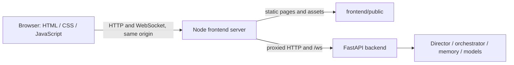

# Frontend and backend boundary

Implemented on the owner's request on 2026-10-02 (D-045). This is an engineering refactor of the existing
agent. Its director, generators, scoped memory, judging and evaluation remain in Python.

## Components

| Component | Entry point | Responsibility |
|---|---|---|
| Browser frontend | `frontend/public/` | Live stage, audio/video playback and presentation acknowledgements, controls, profile editor, trace browser |
| Frontend server | `frontend/server.mjs` | Static assets and a streaming same-origin HTTP/WebSocket proxy; Node built-in modules only |
| Backend | `python3 -m live_agent.backend.app` | FastAPI resource APIs, session orchestration, model clients, private storage and media |
| Compatibility entry point | `python3 -m live_agent.server.app` | Delegates to the backend; it serves the same API and no browser pages |

The frontend and backend have independent processes and ports. The default frontend address is
`http://127.0.0.1:8200`; its backend upstream is `http://127.0.0.1:8201`. These are configuration values,
not performance claims. Browser requests use their current origin, so HTTPS proxies and existing SSH
tunnels only need to expose the frontend. Credentials for model services stay in the backend environment.



## HTTP interface

| Route | Owner | Result |
|---|---|---|
| `GET /`, `/profile`, `/traces` | Frontend | Browser pages |
| `GET /assets/*` | Frontend | CSS and classic JavaScript files |
| `GET /api/health` | Backend | `{status: "ok", generator, protocol_version: 1}` after backend startup |
| `GET /api/curriculum` | Backend | Existing course-knowledge summary |
| `GET /api/curriculum/topics` | Backend | Stored school-topic titles with subject, grade and provenance |
| `GET /api/students` | Backend | Operator-allowed student IDs and basic profile metadata |
| `GET /api/students/{id}` | Backend | Current profile, including its version |
| `PUT /api/students/{id}` | Backend | Apply a validated edit, requiring the current `version` |
| `POST /api/students/{id}/reset` | Backend | Reset to the seed, requiring the current `version` |
| `GET /api/traces` | Backend | Structured recorded-session index |
| `GET /traces/file/{name}` | Backend | JSONL or MP4 download; MP4 supports HTTP range requests |
| `GET /api/traces/{id}/transcript` | Backend | Logged input and planned tutor script with acknowledgement evidence; not verified captions |
| `GET /board/img/{name}` | Backend | Existing content-addressed board PNG |

The frontend proxy preserves HTTP methods, request bodies, upstream status codes and media streaming.
Unknown student IDs return HTTP `404`; stale profile versions return `409`; invalid profile edits return
`422`. Private APIs, trace files and board images carry `Cache-Control: no-store`. The backend does not
serve `/`, `/profile` or `/traces` views. Protocol and HTTP status numbers here identify interfaces, not
measurements.

`GET /api/traces` returns:

```json
{
  "sessions": [
    {
      "id": "sess-example",
      "updated_at": "2026-10-02T00:00:00+00:00",
      "size_bytes": 1024,
      "trace_url": "/traces/file/sess-example.jsonl",
      "videos": [
        {"name": "sess-example.mp4", "label": "presented", "url": "/traces/file/sess-example.mp4"}
      ]
    }
  ]
}
```

The timestamp and byte count above are illustrative values. Entries are sorted by modification time,
newest first, and include only recognized session filenames. Video parts are matched to their own session
rather than all filenames sharing an arbitrary prefix. URLs are relative to the frontend origin.

The student frontend (D-046) supplies `student=<allowed id>` or `mode=public` consistently on recording
index, file and text requests. Unknown legacy attribution is excluded from scoped views; conflicting
scope returns `400` and an unavailable scoped resource returns `404`. The operator API still permits
an unfiltered index, but a direct browser recording-page visit asks for a learner selection. This
navigation scope does not add learner authentication. Current student contracts and limitations are
documented in `docs/student_frontend.md`.

## WebSocket interface

`/ws` retains the existing protocol. The frontend proxy forwards the byte stream without decoding media.
The browser sends a `hello` message with private/public mode, user ID, selected student and supported video
codecs. The backend returns `status`, panel `event`/`state`, user `transcript`, and `chunk` messages.

Student lesson/practice text can carry a validated `lesson_context` and optional `request_id`.
Correlated decision events report whether the decision was applied; lesson/exercise events and pending
exercise state retain the creating activity's ID so the browser can ignore superseded work. Ordinary
text and legacy uncorrelated packets remain supported. These fields do not change media framing.

A `chunk` JSON header contains request and chunk indices, frame count, FPS, sample rate, media duration,
dimensions, scripted transcript, codec and optional board view. For JPEG, the header is followed by one
binary message per frame and a PCM16 binary message. For H.264, it is followed by one Annex-B segment
(access-unit byte lengths in `sizes`) and a PCM16 message. Frame and sample clocks are preserved.

The browser sends `chunk_received`, `chunk_start`, `chunk_end` and clock samples. These remain the backend's
evidence of delivery and presentation; proxy arrival is not treated as user-visible playback. `stop` drops
queued playback on interruption or erasure. Push-to-talk audio, camera opt-in, codec fallback, profile
updates and ping/pong messages retain their current handling. UI captions remain scripted and unverified,
as described in `docs/implementation.md`.

## Local operation and verification

`scripts/run_live.sh demo` supervises the separate frontend and mock backend. Independent start commands,
model-backed modes and environment variables are in `README.md`. A different frontend port requires no
browser code changes; point its `BACKEND_URL` at the desired backend. This local refactor does not deploy
the services or authorize a public broadcast.

Run `python3 -m pytest` for the Python suite and `npm --prefix frontend test` for the browser API helper and
frontend HTTP/WebSocket proxy tests. The existing `scripts/lipsync_page_check.py` should be pointed at the
frontend URL to exercise the extracted playback code through the proxy. These checks do not qualify the
GPU path, model quality or physical audio/video alignment.
